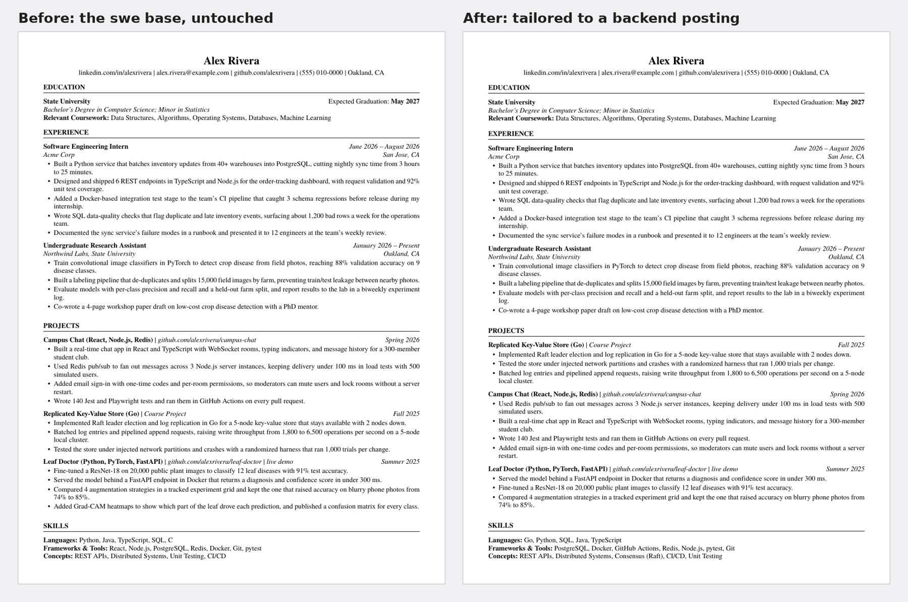

# resume-tailor

A Claude skill that tailors your resume to a job posting and hands back a
one-page PDF. It only picks and reorders bullets from your own library, so
a tailored resume can never claim more than you wrote.



*Left: the example candidate's base resume. Right: tailored to
[a backend posting](examples/sample-posting.md) with
[this plan](examples/sample-plan.json). The distributed-systems project
moved to the top, the posting's stack leads each skills line, and one
bullet was reordered to put PostgreSQL first. No new words were added.*

## Install

**Claude app (claude.ai, desktop, mobile; free accounts work too).**

```bash
git clone https://github.com/jar-narvz/resume-tailor-skill
cd resume-tailor-skill
python3 scripts/package_skill.py --no-library --out .
```

Then, in Claude's **Settings → Capabilities**:

1. Turn on **Code execution and file creation**. The skill runs scripts
   and stops without it.
2. Under **Skills**, upload the `resume-tailor.zip` it created.
3. If you have another resume skill turned on, turn it off so the two
   don't compete.

Start a new chat (outside any Project) to use it. Saved preferences in
your profile outrank a skill, so if yours say something like "edit my
Google Doc resume," Claude may follow that instead.

**Claude Code.** Install the [requirements](#requirements) first
(xelatex and poppler), then:

```bash
git clone https://github.com/jar-narvz/resume-tailor-skill ~/.claude/skills/resume-tailor
python3 -m pip install pyyaml pikepdf
```

## First run: setup

Start a chat and say something like *"set up my resume"*, or just share a
job posting. With no library yet, the skill runs setup first
([references/setup.md](references/setup.md)):

1. It asks for your current resume (PDF, .docx, Google Doc, or pasted
   text) and any older versions. Nothing else yet.
2. It copies every bullet **word for word** into a library, with older
   wordings and old resumes' content kept in an archive. Typos stay in;
   it points them out for you to decide.
3. It asks only what your resumes don't answer (at most four questions):
   which base resumes ("variants") you want, what each shows by default,
   and your graduation date. In Claude Code it also asks about the font.
4. It builds each base resume and shows you the PDFs, with a short list
   of the variants it made and what went to the archive.
5. Once you confirm, it saves the library (see below). If you started
   with a job posting, it tailors to it after that.

Your library never leaves your machine or your Claude account, and
`user/` is in `.gitignore`.

### Where your library lives

- **Claude Code:** the skill is a normal folder on your computer, so
  setup writes your library into `user/` there and every later run finds
  it. Nothing else to do.
- **Claude app:** each chat gets a fresh, temporary workspace that's
  erased when the chat ends, and Claude can read an installed skill but
  can't change it. So a library built during setup would vanish with the
  chat. Instead, setup packs the skill and your library into one zip
  (`resume-tailor-<your-name>.zip`). Upload it under **Settings →
  Capabilities → Skills** and turn off (or delete) the public
  `resume-tailor`. From then on every new chat uses your library
  automatically. When you add bullets later, Claude hands you a new zip
  to upload the same way.

## Usage

- Paste a job link: *"https://job-boards.greenhouse.io/acme/jobs/123"*
- Paste the description: *"Tailor my resume to this: …"*
- Name the role: *"Tailor my resume for the Globex backend intern role"*
- Ask for a cover letter: *"…and write a cover letter, a recruiter at the
  career fair referred me."*
- Add to your library: *"Add a bullet: I cut our CI time from 20 to 8
  minutes by caching Docker layers."*

Each run returns the PDF and its `.tex`, a short summary (which base, what
changed, what the posting asks for that you don't have), and a
comma-separated keyword list to paste into the application's skills field.

## Requirements

- **xelatex** (TeX Live or MacTeX) and **poppler** (`pdfinfo`,
  `pdffonts`, `pdftotext`)
- **Python 3** with `pyyaml` and `pikepdf`

The Claude app's code environment already has these. On a Mac for Claude
Code (MacTeX is a 6.9 GB download, and its installer asks for your Mac
password):

```bash
brew install --cask mactex-no-gui
brew install poppler
python3 -m pip install pyyaml pikepdf
```

Then open a new terminal, and restart Claude Code if it was already
running, so `xelatex` is on your PATH.

If pip stops with `externally-managed-environment` (common when `python3`
comes from Homebrew), rerun it as
`python3 -m pip install --user --break-system-packages pyyaml pikepdf`.
With `--user`, the packages go in your home folder and Homebrew's own
files stay untouched.

On Debian or Ubuntu: `sudo apt install texlive-xetex fonts-texgyre poppler-utils`.

Try it without setting anything up (uses the made-up example library):

```bash
python3 scripts/validate_library.py examples
python3 scripts/build_resume.py --library examples build examples/sample-plan.json out
```

## How it works

```
profile.yaml ─┐
bullets.md   ─┼─> plan.json ─> build_resume.py ─> xelatex ─> checks ─> PDF + .tex
skills.md    ─┤   (Claude       (validate, compose)          (1 page, fonts,
archive.md   ─┘    writes it)                                 text layer, fill)
```

Your library is four plain-text files:

| File | Holds |
|---|---|
| `profile.yaml` | Header, education, font, and your **variants**: base resumes with a section order, experience entries, and default bullets, projects and skills |
| `bullets.md` | Every bullet, each with a stable ID (`acme-3`) |
| `skills.md` | Every skill you can speak to |
| `archive.md` | Content from older resumes, usable but never a default |

For each posting Claude reads the job description, picks the closest
variant, and writes a small **plan**: which projects in which order, which
bullets by ID, and the skills lines. `build_resume.py` validates the plan
against the library, fills the variant's template, compiles it with
xelatex, and checks the PDF. Any check that fails stops the build; Claude
fixes the plan and rebuilds rather than delivering a broken resume. See
[examples/](examples/) for a complete library, posting, plan and output.

## Design decisions

**Library-only bullets.** A plan can name bullets by ID or reframe one,
nothing else. AI-written resume bullets tend to drift toward whatever the
posting asks for, and you're the one who has to answer for every line in
an interview. Tailoring is mostly choosing and ordering anyway.
I built this for my own internship search, where I apply to a lot of
roles. I had already cut C++, REST APIs and Tableau from my resume when I
couldn't back them up in an interview, and I wanted tailoring that could
never quietly add claims like those back.

**Verbatim validation.** A reframe may reorder clauses, swap the leading
verb from a short list, or trim. The build rejects any word whose stem
isn't in the original, any changed number, and any growth over three
words ([reframe-rules.md](references/reframe-rules.md)). Skills face the
same check against your inventory. A rule enforced in code holds up
better than an instruction the model might forget.

**The fill check.** A one-page resume that stops halfway looks thin. When
the content ends at 93–97% of the page, the build stretches the vertical
spacing evenly to the bottom margin. Below 93% it asks for more content
instead, because big gaps look like padding.

**An ATS-safe text layer.** Applicant tracking systems read the PDF's
text, not its picture. The class turns off ligatures (so "fi" doesn't
extract as one glyph), writes a real space character for every visible
space (some parsers glue words otherwise), and embeds every font. The
build checks that each bullet can be recovered from the extracted text.
It also fixes a Times New Roman quirk: the font shares one glyph between
`;` and the Greek question mark (U+037E), and XeTeX labels it as the Greek
character, so every semicolon would reach the ATS as a stray symbol. The
build relabels it in the PDF.
I tested the output by checking each PDF's extracted text and by running
it through Affinda's resume parser. That caught two problems this layout
now avoids. In some parsers, words ran together because the PDF had no real
space characters. And Affinda filed a job title that started with a term
label as a certification instead of a job, so keep labels like that at the
end of a title, in parentheses.

**TeX Gyre Termes instead of bundled fonts.** Times New Roman's license
doesn't allow redistributing the font files, so the default is TeX Gyre
Termes, a free Times clone that ships with TeX Live. On the author's own
resumes it produced the same line breaks and page fill as Times New Roman.
Set `font: times-system` to use Times New Roman installed on your
computer.

**Profile-driven templates.** Header, education and section order live in
`profile.yaml`, and each variant's template is rendered from it on every
build. One edit to your phone number or dates updates every variant, and
there's no hand-maintained LaTeX to get out of sync.

## How it was tested

- **Claude app, example library:** the sample posting built to one page
  with no failed checks. The page fill, bullet count and file size matched
  a build on my Mac exactly.
- **Claude app, first run on a fresh free account:** with a made-up
  candidate's two resumes (a current one and an older data-focused one),
  setup asked only for the files, kept a planted typo, made two variants,
  showed both bases, and handed back a personal zip. Rebuilding from that
  zip on my Mac matched the app's output.
- **Read-only install:** two builds in a row from a skill folder with no
  write permission.

These were manual runs. There's no automated test suite yet.

## Limitations

- **Claude app: re-upload to update.** The app can't save files between
  chats, so your library lives inside the skill zip, and every change to
  it means uploading a new zip.
- **One layout.** A single-column, Times-style resume. Changing the look
  means editing `assets/resume.cls`.
- **LaTeX required.** The build needs xelatex, which is a large install
  outside the Claude app.
- **US-letter, one page,** and English-language section names.
- **One school's graduation date is checked.** Additional schools render
  fine but aren't checked.
- **The optional Google Doc sync is manual.** Claude compares the doc
  with your library and shows you the differences; you confirm each
  addition.

## License

[MIT](LICENSE) © 2026 Jared Narvaez
